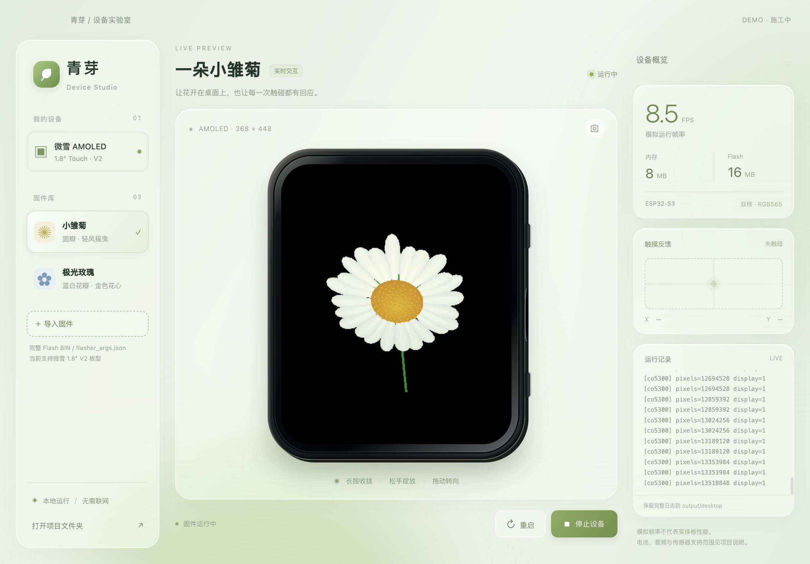
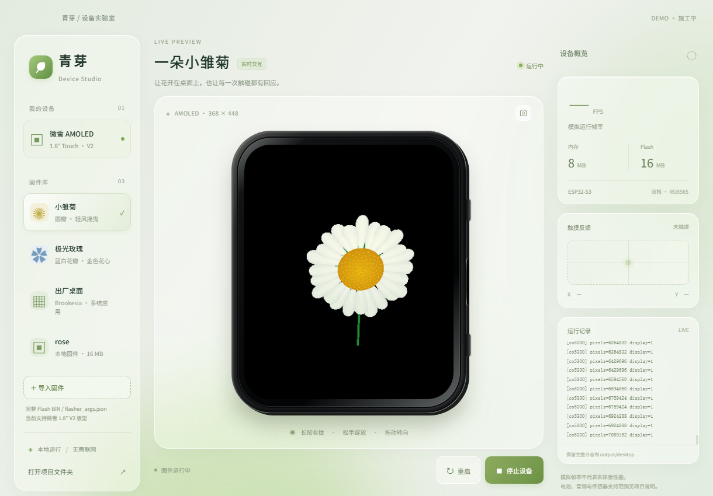
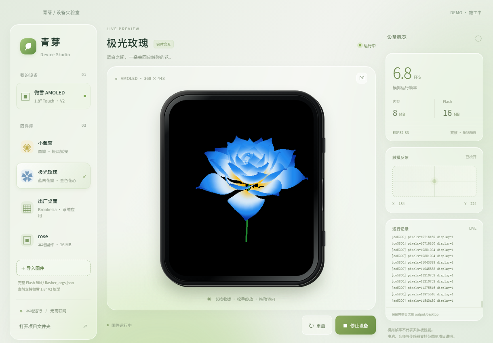
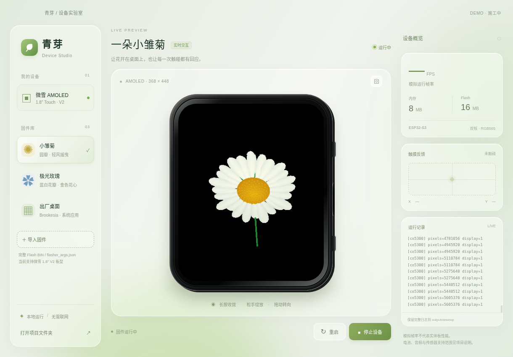
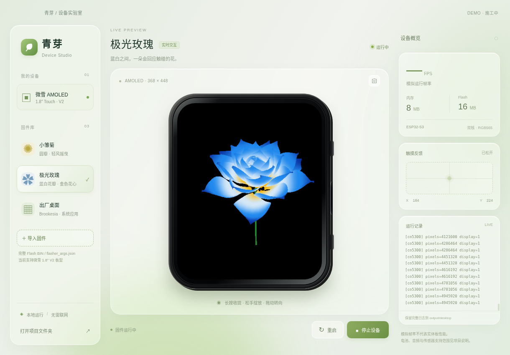
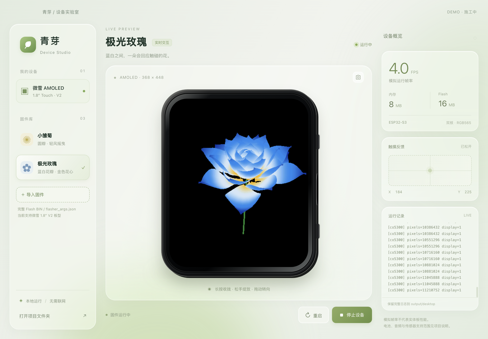
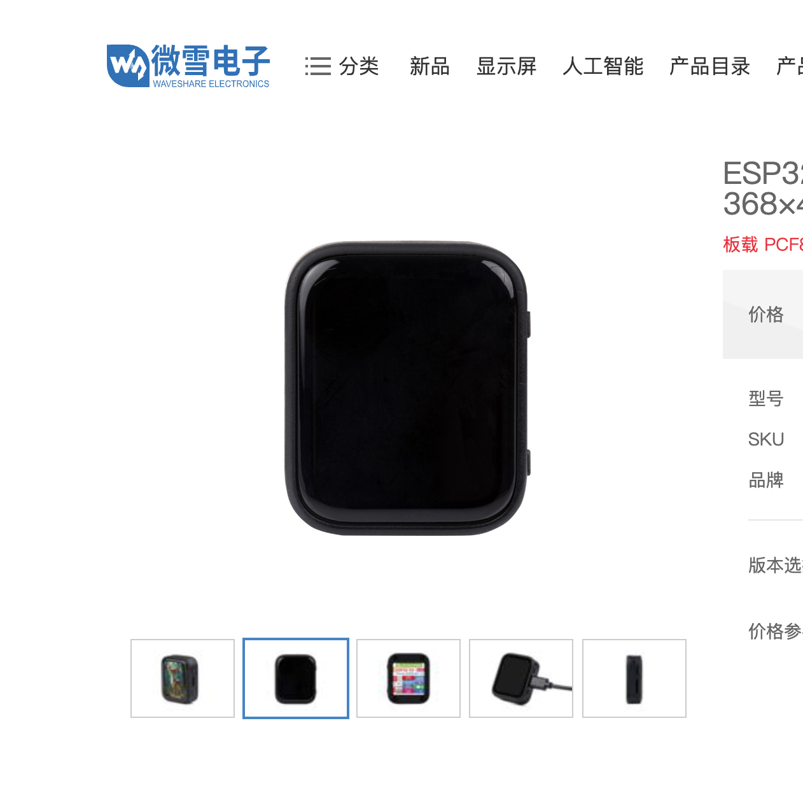
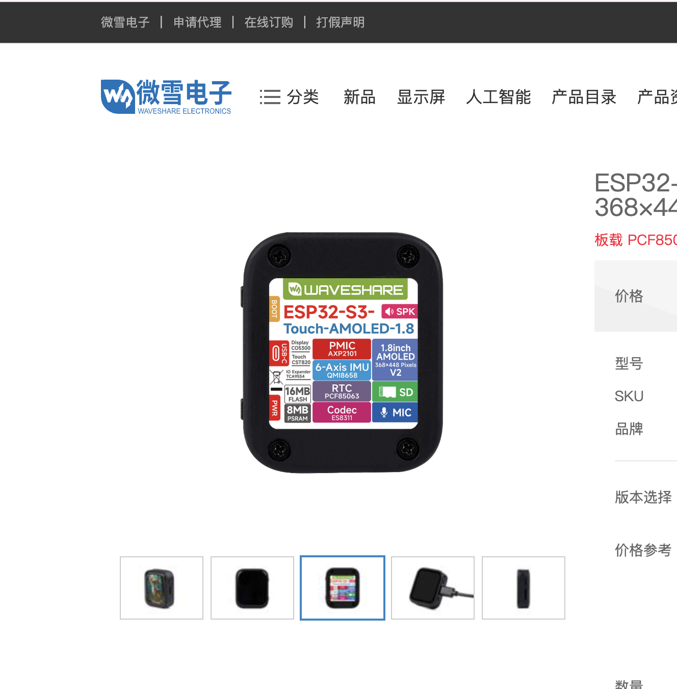
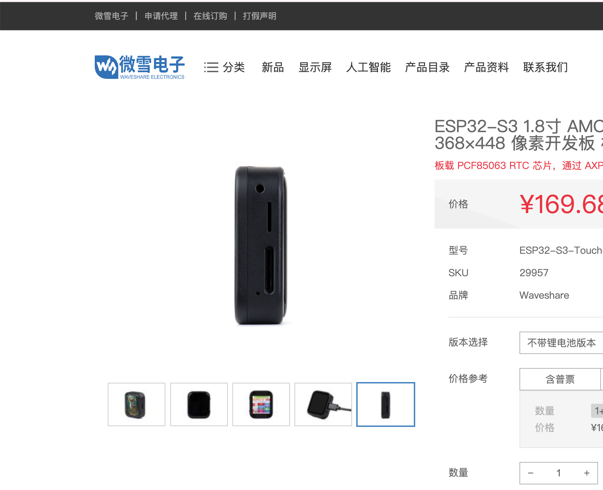

# 青芽 · ESP Emulator

> 🚧 **施工中的 Demo / Work in progress**
>
> 在电脑上先运行固件、看屏幕、试交互，减少早期反复烧录和部分硬件试错成本。当前针对 **微雪 ESP32-S3-Touch-AMOLED-1.8 V2**，不是完整 ESP32 仿真器，不能替代实机的性能、功耗、电气和外设验证。

苹果绿磨砂风格的 Electron 桌面界面，内置雏菊、极光玫瑰两个二进制演示。黑色设备外壳参考微雪实物；屏幕画面由 QEMU 执行固件产生，不是网页花朵动画或预录视频。



## 能玩什么

- 花朵自动摇曳，长按收拢、松手绽放，拖动改变朝向。
- 切换固件、停止/启动、重启、模拟触摸、查看日志、保存 PNG。
- 导入完整 Flash `.bin`，或者选择 ESP-IDF 的 `flasher_args.json`，按偏移自动合并二进制文件。
- 界面为独立 Electron 应用，无需浏览器或 HTTP 服务。首次安装依赖和构建需要联网。

## 三平台实测

| 平台 | 原生 QEMU 编译 | 两朵花显示与交互 | 启停/重启/导入 |
| --- | --- | --- | --- |
| macOS ARM64 | ✅ | ✅ | ✅ |
| Windows 11 x64 | ✅ 原生 `.exe`，非 WSL | ✅ | ✅ |
| Kali Linux x64 | ✅ Ubuntu 22.04 容器构建，Kali 运行 | ✅ Xvfb 虚拟显示 | ✅ |

这是 2026-11-23 的自动化验收结果，不能推广为所有固件兼容。Linux 还没有做实体桌面上的人工操作验收。完整范围见[平台验证记录](docs/PLATFORMS.md)。

### Windows




### Linux（Xvfb）




### macOS 玫瑰



## 获取项目

需要 Git 和 Node.js **22.12 或更高版本**（包含 npm）。Linux、Windows 本次使用 Node 24，macOS 使用 Node 26。

```sh
git clone https://github.com/howtion0/esp_emulator.git
cd esp_emulator
```

当前不提供 Release 安装包，需要先编译 QEMU 后端，再启动 Electron。运行演示不需要安装 ESP-IDF，也不需要连接实体开发板。

## macOS：编译与运行

先安装 [Homebrew](https://brew.sh/)，然后在项目根目录执行：

```sh
brew install git ninja pkg-config python@3.12 glib pixman libgcrypt
JOBS=2 bash scripts/build_qemu.sh
cd desktop
npm ci
npm start
```

已装好依赖后，也可双击根目录的 `启动模拟器.command`。当前实测为 Apple Silicon ARM64；Intel Mac 尚未实测。

## Linux：编译与运行

Ubuntu/Debian 系发行版可使用：

```sh
sudo apt update
sudo apt install -y build-essential ninja-build python3 python3-venv python3-pip \
  python3-tomli pkg-config git curl ca-certificates libglib2.0-dev \
  libgcrypt20-dev libpixman-1-dev zlib1g-dev
JOBS=1 bash scripts/build_qemu.sh
cd desktop
npm ci
npm start
```

需要正常图形桌面。远程/CI 环境可在安装 `xvfb` 后使用虚拟显示跑验收：

```sh
sudo apt install -y xvfb
cd desktop
xvfb-run -a -s '-screen 0 1440x1000x24' npm run test:ui
```

本次低内存远端的 QEMU 构建限制为 2 CPU、2 GiB RAM，编译 `-j1`；这些是实测资源限制，不是所有环境的最低需求。

## Windows：编译与运行

安装 Git、Node.js 和 [MSYS2](https://www.msys2.org/)。在 **MSYS2 UCRT64** 终端中执行更新；若提示关闭终端，重新打开 UCRT64 后继续：

```sh
pacman -Syu
pacman -S --needed make diffutils git \
  mingw-w64-ucrt-x86_64-gcc mingw-w64-ucrt-x86_64-ninja \
  mingw-w64-ucrt-x86_64-python mingw-w64-ucrt-x86_64-python-pip \
  mingw-w64-ucrt-x86_64-pkgconf mingw-w64-ucrt-x86_64-glib2 \
  mingw-w64-ucrt-x86_64-libgcrypt mingw-w64-ucrt-x86_64-pixman

# 改为自己的仓库位置，例如 E:\projects\esp_emulator
cd /e/projects/esp_emulator
JOBS=2 PYTHON=/ucrt64/bin/python.exe bash scripts/build_qemu.sh

# 收集实际依赖的 MinGW DLL，避免依赖终端中的 PATH
python scripts/collect_windows_runtime.py \
  qemu-source/qemu-esp-develop-9.2.2-20260417-src/build/qemu-system-xtensa.exe \
  /ucrt64/bin runtime/win32-x64
mkdir -p runtime/win32-x64/bios
cp qemu-source/qemu-esp-develop-9.2.2-20260417-src/pc-bios/esp32s3_rev0_rom.bin runtime/win32-x64/bios/
```

再在 PowerShell 或 CMD 中进入项目：

```powershell
cd E:\projects\esp_emulator\desktop
npm ci
npm start
```

后续可双击 `启动模拟器.cmd`。没有可用 GPU 的远程会话，可以在 PowerShell 设置 `$env:QEMU_SOFTWARE_RENDERING='1'` 再启动。

## 构建脚本做了什么

`scripts/build_qemu.sh` 获取 Espressif QEMU 固定版本 `esp-develop-9.2.2-20260417` 及子模块，应用 `qemu-source-overlay/`，构建 Xtensa 模拟器。可复用本地源码包；首次从网络克隆可能较慢。

- 可执行文件位于 `qemu-source/qemu-esp-develop-9.2.2-20260417-src/build/`。
- Windows 文件名带 `.exe`。
- 可通过 `QEMU_BIN` 指定自定义可执行文件。
- 启动还需要 `esp32s3_rev0_rom.bin`；应用会显式传入 ROM 搜索目录。
- 平台运行包目录为 `runtime/<平台>-<架构>/`，详见[架构说明](docs/ARCHITECTURE.md)。

## 如何导入并运行自己的固件

1. 点击左侧 **＋ 导入固件**。
2. 选择完整 Flash `.bin`；或者选择 ESP-IDF 的 `build/flasher_args.json`，保留它引用的所有二进制文件。
3. 导入后自动出现在固件库并启动。

**只导入二进制，不需要复制应用源码。** 单独的 `build/项目名.bin` 通常缺少启动器和分区表，不能当成完整 Flash。当前检查 ESP32-S3 芯片标识、默认位置的分区表、应用、16 MB 容量及片段重叠；通过格式检查不等于板型兼容。

导入不会修改原文件。运行使用 Flash 快照，停止后不保留固件写入。完整示例与合并命令见[导入指南](docs/IMPORTING_FIRMWARE.md)。

## 项目分层

| 目录 | 职责 |
| --- | --- |
| `desktop/src/ui/` | 界面、外壳、触摸坐标 |
| `desktop/src/electron/` | 窗口、原生文件对话框、隔离 IPC |
| `desktop/src/core/` | 不依赖 Electron 的会话、QMP、固件处理 |
| `desktop/src/platform/` | 系统路径与运行库定位 |
| `qemu-source-overlay/` | C 编写的外设模型及修复 |
| `demos/flowers/` | 仅两朵花的完整 Flash 二进制 |
| `desktop/test/` | 导入与通信测试、真实固件的 UI 验收 |
| `docs/images/` | 三平台花朵截图与微雪实物参考 |

```sh
cd desktop
npm test          # 固件解析、合并、去重、异常输入和 QMP 通信
npm run test:ui   # 需要已编译的 QEMU；真实运行花朵并输出截图
```

UI 验收的系统文件选择器使用固定路径，其他导入、存储、执行流程走真实代码。输出保留在本地 `output/`，不提交仓库。

## 目标硬件与外壳

微雪 **ESP32-S3-Touch-AMOLED-1.8 V2**：368×448 AMOLED、CO5300、CST820、16 MB Flash、8 MB PSRAM。具体信息以[微雪官方文档](https://docs.waveshare.net/ESP32-S3-Touch-AMOLED-1.8/)为准。

| 正面 | V2 背面标识 | 侧面 |
| --- | --- | --- |
|  |  |  |

实物图片来自用户提供的微雪产品页截图，版权和商标归原权利人。CSS 外壳是外观近似，不是尺寸精确的 CAD，也不表示微雪官方参与。

## 当前限制与发布范围

- 显示、触摸与部分 Flash/I2C/GPIO 行为已针对本板实现，仍有简化模型。
- 真实 Wi-Fi、音频、电池、IMU 运动与电气时序没有完整仿真。
- 模拟 FPS 不是实体板性能；其他板型、V1 引脚或不同控制器不保证可运行。
- 公开演示只包含两朵花。其他本机固件仅作兼容性验证，其二进制、源码、日志及截图不上传。
- 当前未发布 Release；这是可用于早期试验、仍在施工的 Demo。

许可证边界及上游信息见[第三方说明](docs/THIRD_PARTY.md)。保留仓库原有 LICENSE；它不替代 QEMU 及其他第三方代码的许可证。
