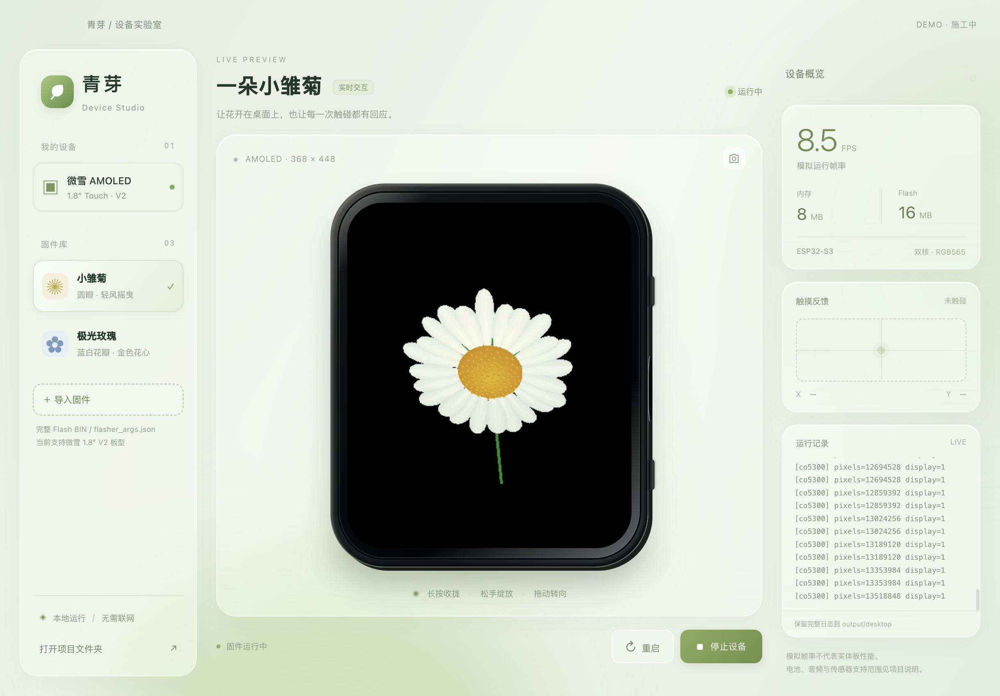
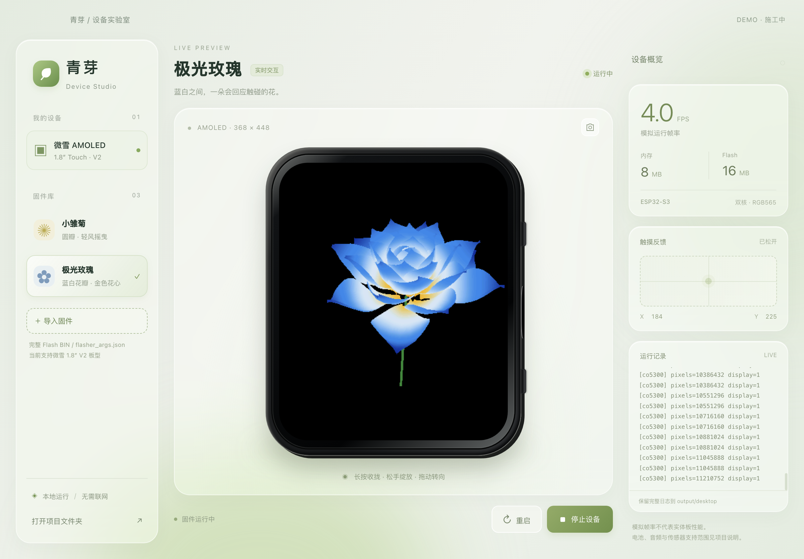
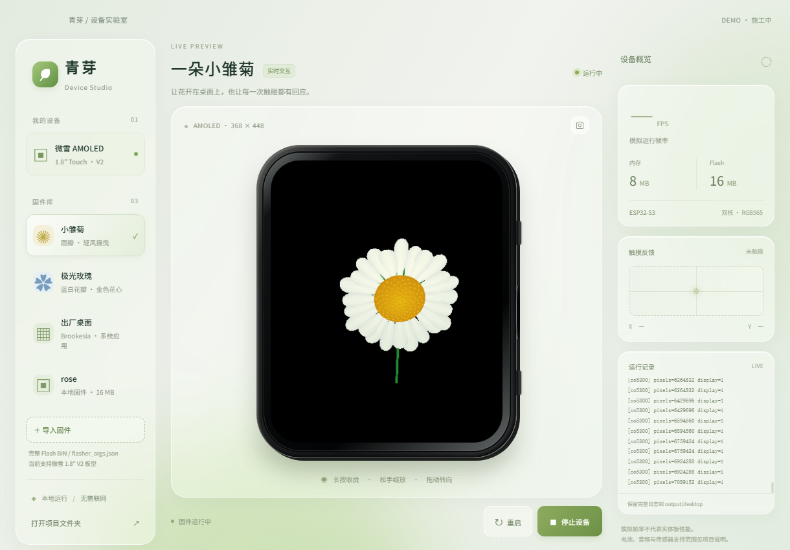
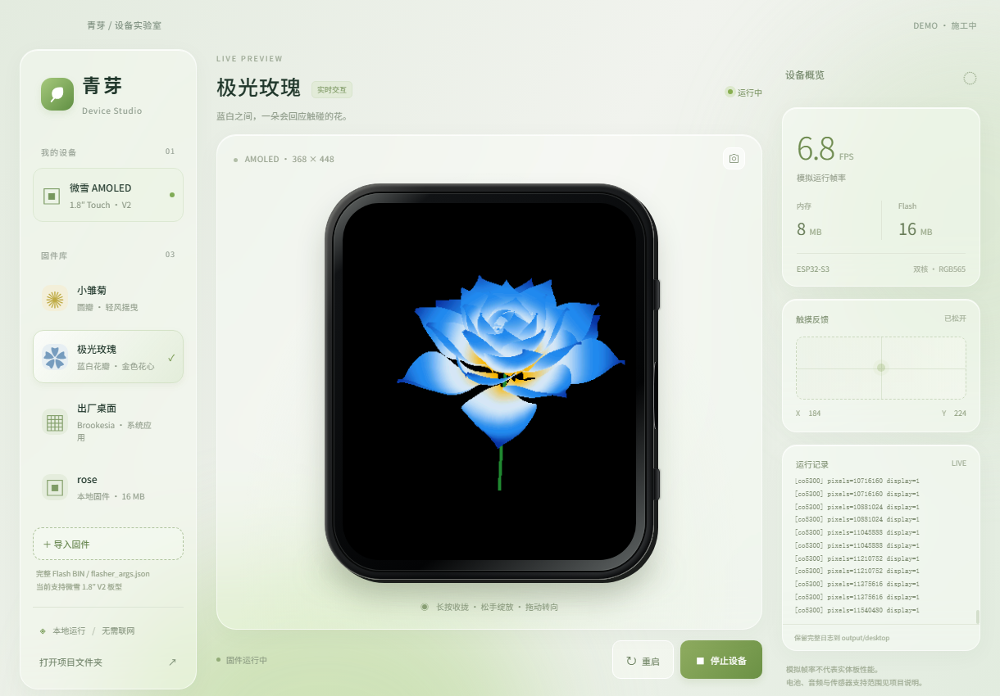
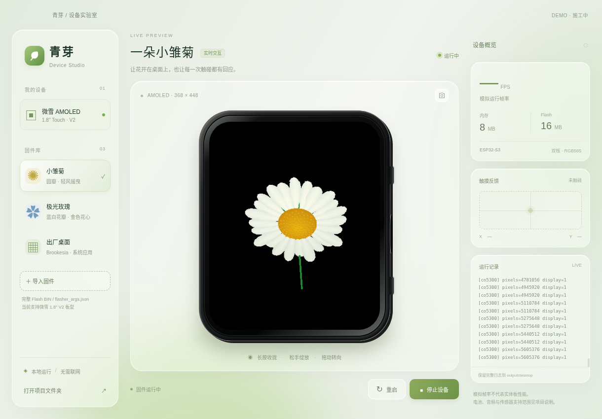
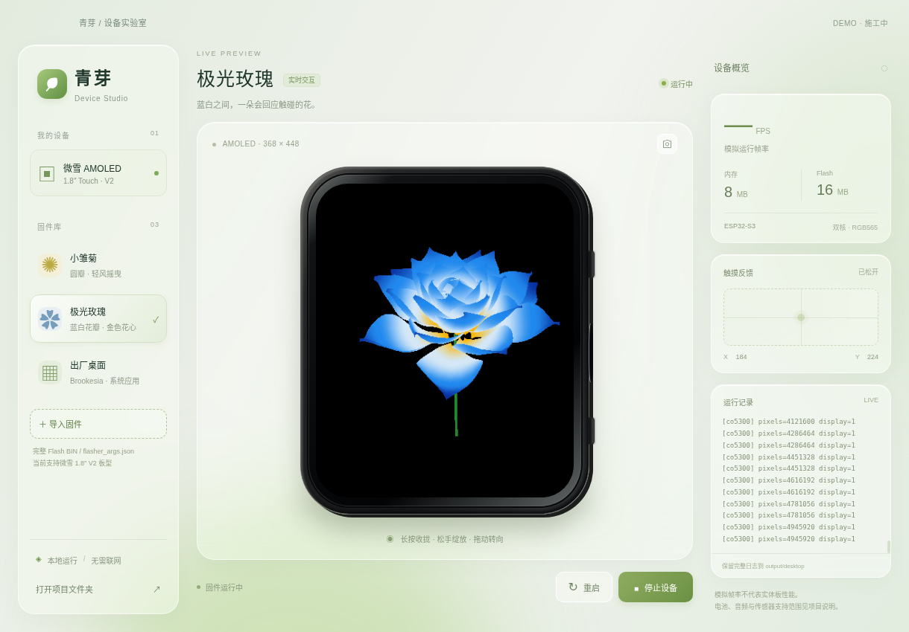

# 三平台验证 · 2026-11-23

| 平台 | QEMU 原生构建 | 花朵显示与交互 | 停止/启动、重启 | 导入固件 |
| --- | --- | --- | --- | --- |
| macOS ARM64 | 通过 | 通过 | 通过 | 通过 |
| Windows 11 x64 | 通过，原生 `.exe` | 通过 | 通过 | 通过 |
| Kali Linux x64 | 通过，在独立 Ubuntu 22.04 容器构建后于 Kali 运行 | 通过，Xvfb 虚拟显示 | 通过 | 通过 |

这里的“通过”指本次自动化用例：雏菊和玫瑰产生画面、长按/松手、切换、启停、重启、导入后运行。文件选择器在自动化测试中使用固定路径，导入解析、保存和实际运行仍走真实代码。

Linux 截图来自真实 Linux Electron 进程的 Xvfb 虚拟显示，不是 Mac 截图；尚未进行实体桌面上的人工操作验收。Windows 不是 WSL。远程会话可以使用 `QEMU_SOFTWARE_RENDERING=1` 启动软件渲染。

截图与模拟 FPS 不是实体开发板性能测试。网络、电池、音频及 IMU 的完整行为尚未实现，不能据此认定任意 ESP32-S3 固件都兼容。

## macOS

## Windows

## Linux（Xvfb）

